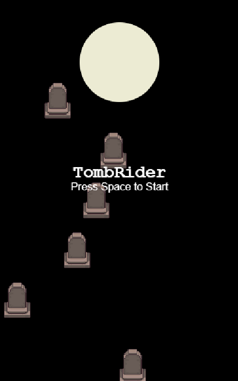
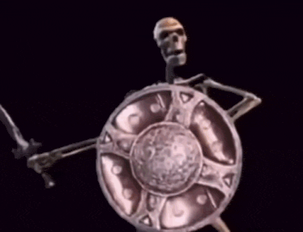
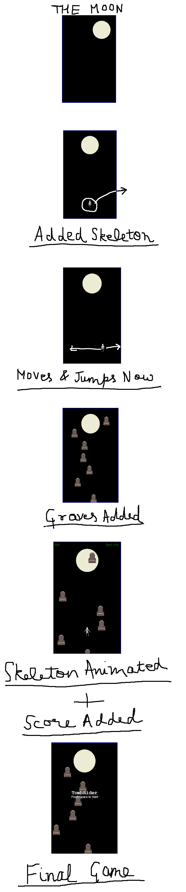

## TOMB RIDER
skeleton jump game, the closer you get to the moon the more points you get.

# HOW TO PLAY

press space to start playing, use "A" or "D" to move left or right, jump on the tombs and get more points, beat your high score/best score.

# ABOUT

i added collision with detect collision. for smooth jumping i added if(detectCollision(doodler,grave)&&velocityY>=0) which ensures it doesnt jump by just touching the grave when coming up from below which it will make the physics look a bit unrealistic. so it wont just collide and go up smoothly, and then whenever the collision happens and velocityY>=0 which means its coming down then we make velocityY=initialVelocityY.

then added the point system where if you go up you gain points and store that in max points variable so that if you are going down, and then going up again it doesnt add extra points for you rather it just keeps your score the same unless you go above than you previously had.

added the skeleton animation, used row1 of the spritesheet, where the arms go from down to up making a fly type animation. the frames are tied to velocityY so the arms go up smoothly. a variable t runs from 0 to 1 , its 0 right after a bounce, 1 at the top since the velocity at the top is 0. then it counts back as the skeleton falls. then translated t into a column number using math floor because sprite only accepts whole numbers. also one interesting thing is i was using max col before but changed it to max col +1 because doing that varies it from 0 to 6 giving each animation equal number of time steps so that it looks better.

also fixed the container, the skeleton would go around the screen, and come out from the other side. fixed it so it would stay in the board.

added sound using webaudioapi, i used midi note numbers to convert the notes to frequency where a4 is 69, the formula is f=440*2^((n-69)/12) which gives the frequency of particular note represented by a midi number. each note starts at its volume and fades towards 0.001 over duration, and the oscillator stops at the moment the fade ends, i set the exponentialRampToValue to 0.001 and not 0 because its exponential curve and they reach 0 at infinity also webaudio throws an range error if you write 0 inside it, 0.001 works well because its -60decibels which is basically no sound. used notes of A minor chord for the start sound (A,C,E) going up A4,C5,E5. for game over sound i used the same A minor chord but going down the octave E5,C5,A4 then a low A3 at the end, used square waves + low filter cutoff, so it sounds dull and heavy removing some of the treble. for the jump sound i used a single A4 note.

